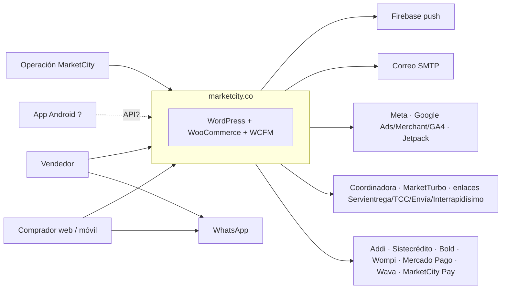
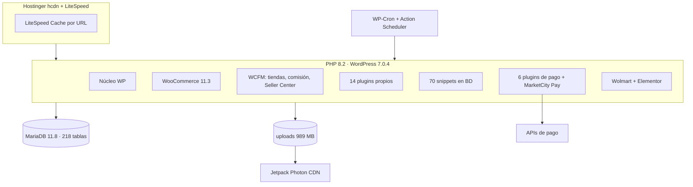

# 05 · Arquitectura actual (as-is) — marketcity.co

- **Fecha:** 2026-11-17. Amplía `docs/archivo/fase-0/discovery/as-is-system-map.md` (Fase 0) con lo confirmado en el clon y hoy en el sitio público.
- Convenciones: HECHO (verificado), INFERENCIA, PENDIENTE.

## 1. Versiones y piezas (línea base)

| Capa | Valor | Estado |
|---|---|---|
| Hosting | Hostinger (plan compartido/cloud; cabeceras `platform: hostinger`, `panel: hpanel`) | HECHO (AUD-E-001) |
| Borde / CDN | `hcdn` de Hostinger con HTTP/3 (`alt-svc h3`); `x-hcdn-cache-status: BYPASS` en el inicio | HECHO |
| Servidor web | LiteSpeed (`x-litespeed-cache`) | HECHO |
| PHP | 8.2.35 (Hostinger), memoria WordPress 3 GB | HECHO (Fase B, WC Estado) |
| Base de datos | MariaDB 11.8.9, prefijo `wp_`, **707,8 MB** hoy (70 % analítica de WCFM en el volcado de Fase 0) | HECHO (Fase B) |
| CMS | WordPress **7.1.4** (actualizado desde 7.0.4 del clon de Fase 0) | HECHO (Fase B) |
| Comercio | WooCommerce 11.3.0, HPOS desactivado | HECHO |
| Marketplace | WCFM Marketplace + Frontend Manager + Membership | HECHO |
| Tema | Wolmart 1.10.0 + hijo vacío | HECHO |
| Caché | LiteSpeed Cache (página), sin Redis/Memcached | HECHO / INFERENCIA |
| Colas / cron | Action Scheduler 4.1.0 (28 943 acciones registradas) + WP-Cron; 989 fallidas en Fase 0 | HECHO (R-020) |
| Correo | FluentSMTP (proveedor SMTP: PENDIENTE) | HECHO / PENDIENTE |
| Medios | `wp-content/uploads` 989 MB; servidos por Jetpack Photon (`i0.wp.com`) | HECHO |
| Analítica | GTM, GA4 (`_ga_SCT1W4VREG`), Meta Pixel (`_fbp`), Jetpack Stats (`tk_*`), Sourcebuster (`sbjs_*`), mc-insights | HECHO (cookies en AUD-E-001) |
| App Android | Existe mención; código y backend desconocidos | PENDIENTE (Q-014) |

**Cookies de analítica en el dominio raíz:** `_ga`, `_fbp`, `sbjs_*`, `tk_*` se crean para `.marketcity.co`, así que también llegan a `v1.marketcity.co` (observado hoy). Hay que tenerlo en cuenta en el consentimiento y en las pruebas de v1.

## 2. Diagrama de contexto

## 3. Diagrama de contenedores

## 4. Línea base medida hoy (AUD-E-001…E-004)

| Métrica | Valor (marketcity.co) | Cómo se midió |
|---|---|---|
| Respuesta del servidor, inicio | 0,2 s con caché; 1,9–2,0 s sin caché (`x-hcdn-upstream-rt 1.890`) | `fetch` sin caché desde el navegador del propietario |
| Respuesta, otras páginas sin caché | 1,8 – 7,0 s; Seller Center sin sesión 11–13 s | ídem |
| HTML transferido | 249–307 KB comprimidos (550–900 KB sin comprimir) | Navigation Timing |
| Peticiones por página | 79–95; 750–920 KB transferidos | Resource Timing |
| Scripts por página | 111–113 | DOM |
| CLS | 0 en inicio y ficha | PerformanceObserver |
| LCP / INP | **PENDIENTE**: el panel del navegador estaba en segundo plano y el entorno de nube no llega a PageSpeed (Q-015) | — |
| Accesibilidad (automática básica) | Inicio: 50/151 imágenes sin alt, 2 campos sin etiqueta, 4 enlaces/botones sin nombre. Ficha: 10 sin alt, 5 sin etiqueta, 3 sin nombre | DOM |
| Errores de consola | 484 en una carga de ficha (`o.update is not a function`) | consola |
| Recursos rotos | CSS de Sistecrédito 404 | red |
| Cabeceras de seguridad | Solo `content-security-policy: upgrade-insecure-requests`. Faltan HSTS, X-Frame-Options, X-Content-Type-Options, Referrer-Policy, Permissions-Policy | respuesta HTTP |
| TLS | Válido, HTTP/3 disponible. Detalle de cifrados: PENDIENTE (requiere escáner autorizado) | — |
| SEO | Sitemap nativo `/wp-sitemap.xml`; canonical presente; JSON-LD Organization/WebSite/Product/BreadcrumbList; páginas de cuenta y `/estadisticas/` indexables; `/cart/` duplicado indexable | DOM |
| Catálogo público | 644 productos, 15 categorías, 0 variables, 5 en oferta, 0 agotados visibles; en una muestra de 100: 95 sin SKU, 5 nombres repetidos, 0 con reseñas | Store API pública |

## 5. Salud operativa (de Fase 0)
- 989 tareas programadas fallidas (65 de Google Merchant, 1 webhook de WooCommerce).
- 0 retiros en WCFM: la liquidación se hace a mano.
- 129 pedidos totales; 38 % cancelados (Q-026).
- Sin copias de seguridad ni restauración probadas (A-01, A-02, A-05).
