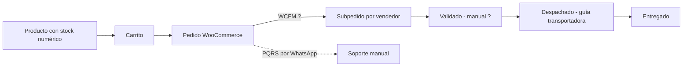

# Mapa de integraciones — as-is

Estado de cada integración: **ANUNCIADA** (mencionada públicamente), **INFERIDA** (indicio técnico), **CONFIRMADA** (contrato/config verificada; ninguna lo está aún).

## 1. Tabla de integraciones

| Dominio | Proveedor | Estado | Evidencia | Qué falta confirmar | Propietario |
|---|---|---|---|---|---|
| BNPL | Addi | ANUNCIADA | E-001, E-007, E-009 | Contrato, plugin, modalidad (checkout alojado/redirect), webhooks, comisión, quién asume cartera | POR DEFINIR |
| BNPL | Sistecrédito ("MarketCityPay") | ANUNCIADA | E-001, E-007 | Qué es "MarketCityPay" (marca propia, convenio, cupo), plugin, webhooks | POR DEFINIR |
| Pasarela | Bold ("Tarjeta y pago en línea") | ANUNCIADA | E-001, E-007 | Si Bold procesa tarjetas, PSE, Nequi y Daviplata o si hay otros conectores | POR DEFINIR |
| Pago | PSE, Nequi, Daviplata | ANUNCIADA | E-001, E-007 | Agregador real | POR DEFINIR |
| Tarjetas | Visa, MC, Amex, Diners | ANUNCIADA | E-001 | Alcance PCI (SAQ-A esperado si es alojado) | POR DEFINIR |
| Logística | Servientrega, Coordinadora, Envía, Inter Rapidísimo, TCC | ANUNCIADA (solo enlace de tracking) | E-006 | ¿Generación de guías integrada o manual? ¿Agregador? | POR DEFINIR |
| Logística | Envia.com, MiPaquete, Melonn, Rappi | ANUNCIADA (en política) | E-007 | Contratos, uso real, tarifas, cobertura | POR DEFINIR |
| Logística (propio) | Plugin `marketcity-envios` | INFERIDA | E-006 | Código fuente, funciones, autor | POR DEFINIR |
| Mensajería | WhatsApp (enlaces `wa.me`) | CONFIRMADA (solo enlaces) | E-004, E-011 | ¿WhatsApp Business App o API? ¿Plantillas? ¿CRM? | POR DEFINIR |
| Correo | Correo transaccional de WooCommerce | INFERIDA | E-004, E-024 | Proveedor SMTP, SPF/DKIM/DMARC | POR DEFINIR |
| Notificaciones | Opt-in "ofertas, cupones y novedades" | ANUNCIADA | E-001, E-021 | Herramienta (push web, SMS, correo), registro de consentimiento | POR DEFINIR |
| Analítica | Meta Pixel (ID público en HTML) | CONFIRMADA (presente) | E-001 | ¿Se dispara antes del consentimiento? Conversions API | POR DEFINIR |
| Analítica | Google Search Console (meta de verificación) | CONFIRMADA (presente) | E-001 | Acceso de lectura | POR DEFINIR |
| Analítica | GA4 / GTM | No observada | E-001 | Confirmar ausencia | POR DEFINIR |
| CDN medios | Jetpack Photon (`i0.wp.com`) | INFERIDA alta | E-001, E-003 | Plan Jetpack, dependencia de WordPress.com | POR DEFINIR |
| Búsqueda visual | Desconocido ("en el dispositivo") | ANUNCIADA | E-001 | Librería/modelo, licencia, envío de imágenes | POR DEFINIR |
| Marketplace | WCFM Marketplace (+Membership) | INFERIDA alta | E-009, E-004 | Versión, licencia Ultimate, comisiones, retiros | POR DEFINIR |
| Tema | Wolmart | INFERIDA alta | E-008, E-009 | Licencia, child theme, personalizaciones | POR DEFINIR |
| App móvil | App Android MarketCity | ANUNCIADA | E-022 | Repositorio, API consumida, cuenta de Play Console | POR DEFINIR |
| Hosting/DNS/TLS | Desconocido | No observable | E-027 | Proveedor, plan, backups, accesos | POR DEFINIR |

## 2. Flujo de dinero (borrador — **bloqueo explícito**)

```mermaid
flowchart LR
  C[Comprador] -->|checkout| WC[WooCommerce pedido]
  WC -->|redirect/iframe ?| PSP{Bold / Addi / Sistecrédito}
  PSP -->|confirmación ? webhook/retorno| WC
  PSP -->|desembolso ? a MarketCity| MC[(Cuenta MarketCity)]
  MC -->|liquidación: 10 días hábiles tras la venta (propietario, 2026-11-13); mecanismo ?| V[Vendedor]
  WC -->|comisión ? WCFM| LEDGER[(Comisiones WCFM)]
```

Todo arco con "?" es desconocido. Preguntas bloqueantes: ¿quién es el comercio registrado ante cada PSP (MarketCity o el vendedor)?, ¿el dinero llega a MarketCity y luego se liquida al vendedor?, ¿con qué periodicidad y retenciones?, ¿cómo se concilian comisiones y reembolsos? (Q-004, Q-005, Q-006).

## 3. Flujo de pedido e inventario (borrador)



Estados públicos: Recibido → Validado → Despachado → Entregado (E-005). Reserva de stock, cancelación, devolución y reembolso: no observados.

## 4. Flujo de datos personales (borrador)

Captura: registro (correo), checkout (no observado), alta de vendedor (CC/NIT, dirección, teléfono), formularios de contacto (nombre, celular, ciudad, pedido) que salen por WhatsApp, píxel de Meta, opt-in de notificaciones, app Android. Transmisión declarada a aliados financieros, logísticos, tecnológicos y centrales de riesgo (E-007). Ver `docs/security/initial-threat-model.md`.
